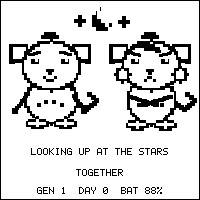
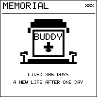
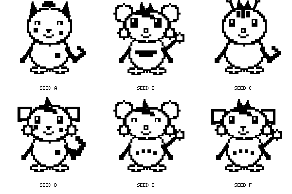
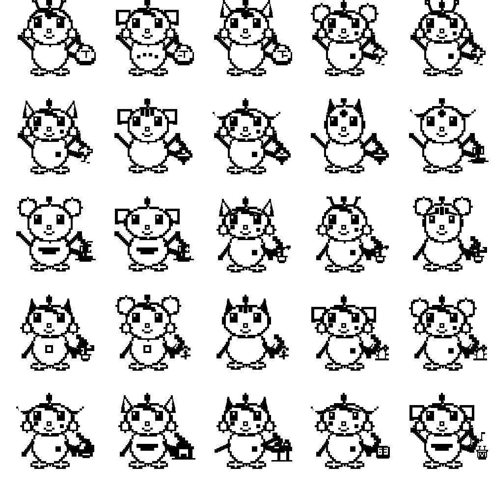
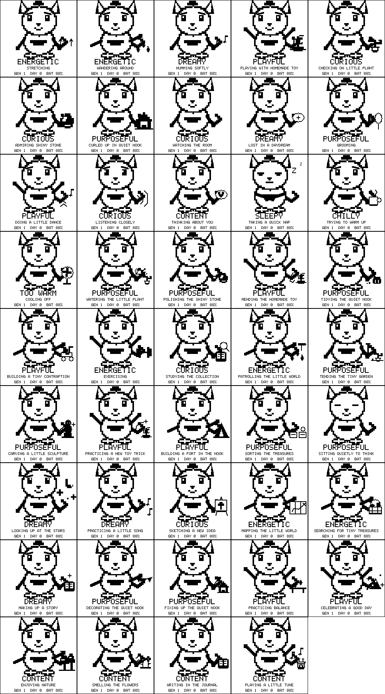

# Buddy

### A little life, all his own.

Buddy is a pocket-sized, autonomous artificial-life companion for the **Waveshare ESP32-S3-ePaper-1.54 V2 monochrome, non-touch board**. He grows up, develops preferences, finds things to care about, works on projects, builds a home, gets older, and eventually leaves his world to another generation.

You can spend time with him, but you are not responsible for keeping a chore meter full. Buddy is meant to have a life of his own. Sometimes the fun is interacting; sometimes it is simply noticing what he has decided to do today.

## Want the practical version first?

- [Owner Guide (Word)](docs/manuals/Buddy%20Owner%20Guide.docx) — for adults who want to understand Buddy and use him confidently.
- [Family Owner Manual (Word)](docs/manuals/Buddy%20Family%20Owner%20Manual.docx) — a simpler, child-friendly introduction.
- Prefer reading on GitHub? Here are the [owner guide](docs/manuals/owner-guide.md) and [family manual](docs/manuals/family-manual.md) as web pages.

The manuals explain day-to-day use in plain language. This README takes a broader look at what Buddy is, how his simulated life develops, and what the firmware is designed to do.

**Current release: `2026101701`.** Buddy is freeware, not open-source firmware. The firmware, Buddy-created artwork, and sounds remain copyrighted; firmware source and raw creative assets are not part of the public package. Installer utilities are separately MIT licensed. Third-party components retain their own terms. The release includes exact matching application objects and a tested source-private LGPL relinking procedure. See [license scope](LICENSE-SCOPE.md) and [third-party notices](THIRD_PARTY.md).

## What makes Buddy different?

- **An individual, not a repeated animation.** Appearance, temperament, needs, learning, memories, and possessions influence what he chooses to do.
- **A long life.** A life averages one real year, with seeded variation from 305 to 425 days. Baby, child, young, adult, and elder stages bring different looks and behavior.
- **A world that outlasts him.** A house, handmade works, family customs, and limited inherited preferences can connect one generation to the next.
- **Autonomous activity.** Exploration, making, gardening, music, reflection, rest, and self-comfort are part of his own routine. Your input is an addition, not a prerequisite.
- **A physical companion.** Temperature affects him; e-paper preserves his face when sleeping; a single button keeps the interface small.
- **Cable Friends.** Two owners can deliberately connect two Buddies with an ordinary USB-C cable and see them spend time together.
- **Local operation.** Buddy's life runs on the board itself; no cloud service or internet connection is required.

<p>
  
  
</p>

These are host-rendered artwork previews, not photographs or evidence of a particular physical test. The meeting scene and memorial represent different moments in a long-running world.

## A life that develops

Each Buddy starts with a distinct seed, visual characteristics and a combination of curiosity, sociability, playfulness, resilience, sensitivity, and independence. Different devices do not deliberately start with identical generation-one lives.

On a brand-new installation, a short WELCOME sequence lets the owner choose a boy or girl Buddy, a first keepsake, and an initial spark: exploring, making, dreaming, or friendship. Those choices influence the starting point; they do not lock him into a fixed script. Existing lives skip this setup when updated.

Over time, needs and experiences interact with temperament. Something enjoyable can become a favorite. Repetition can become a routine. An object can become familiar, a project can matter, and an inherited piece of the world can invite a new generation to take an interest. A sensitive Buddy and an independent Buddy need not respond to the same situation in the same way.

This is a designed, rule-based artificial-life simulation with persistent state. It is **not a conversational language model**, a claim of consciousness, or a creature that understands unrestricted speech. Its individuality comes from the interaction of many small systems over time rather than a remote AI writing its dialogue.



*These six portraits are a small sample, each drawn from a different fixed seed at the same adult stage. Buddy uses a 32-bit starting seed, giving roughly 4.3 billion possible seed values. That is the size of the seed space, not a promise of 4.3 billion visibly unique portraits: different seeds can share features, and a Buddy's appearance also changes as he grows.*

### How an individual life takes shape

Buddy's personality is not a label that dictates every action. His temperament, current needs, age, temperature, learned preferences, memories, possessions, and the state of his world all help shape what he is inclined to do. Those influences can reinforce or soften one another: an experience that suits one Buddy may be passed over by another.

The firmware repeatedly makes small choices about what matters next. A visible scene is only the moment you happen to catch; underneath it, activities can contribute to preferences, routines, projects, and the changing world. Repetition can make an interest feel familiar, while a new experience can lead him somewhere else. The intention is for behavior to have context and consequences, not just to swap randomly between animations.

Your interaction is an invitation, not a care requirement. You can meet him in the moment, and the first-start choices give him a starting point, but there is no daily checklist you must complete to keep him alive or progressing. Left alone, he continues to act and develop.

### A glimpse of an ordinary day

There is no fixed daily script, but imagine a curious Buddy noticing his grove, pausing to enjoy the flowers, then spending some of his attention on a longer project at home. Another Buddy might prefer a quieter activity, return to a familiar keepsake, or choose to rest. The same world offers possibilities; each individual arrives at them with different needs and experiences.

Over many days, small choices add up. A favorite can become part of a routine. House work takes far longer than one screen or one interaction, and the home can outlast its builder. When a new generation arrives, it inherits a world with history—but it is not a copy of the previous life. What the next Buddy notices and cares about can take the story in a new direction.

## What he actually does

Buddy has eight world anchors to discover and form attachments to:

| Anchor | Some of its roles in his world |
| --- | --- |
| Stone | A keepsake to admire, polish, and work with |
| Plant | Something to tend, water, and watch develop |
| Nook | A quiet place to rest, tidy, and improve |
| Homemade toy | Something to play with, mend, and invent around |
| Grove | A place to enjoy nature and explore |
| Flowers | Something to smell, enjoy, and care for |
| Journal | A place for writing, ideas and reflection |
| Instrument | A focus for practice, music, and little tunes |



*Rendered from the firmware's item-art functions; the variations show how familiar objects can look different in individual lives.*

They are not eight buttons the owner must manage. They provide opportunities for Buddy's own choices. His broader repertoire also includes stretching, wandering, watching the room, daydreaming, grooming, dancing, exercising, collecting treasures, sketching, mapping, telling stories, decorating, stargazing, and other moments.

Small activities can contribute to longer work. Projects and ambitions have progress and consequences beyond the current picture. Not every Buddy takes up the same interests, and not every interest has to become a lifelong commitment. Item artwork has individual variations, so two homemade toys need not look identical.

<details>
<summary>See a selection of activity artwork</summary>



This gallery demonstrates rendering possibilities. It is not an owner's checklist, and a particular Buddy will not show every scene in a short session.

</details>

## A home, a family, and an ending

House construction is a long-running undertaking, not an instant interaction reward. Buddy can gradually build a home, use it, maintain it, and leave it behind. The house belongs to the world rather than being reset for every new life. Later generations may inherit it, but it wears, can become a ruin and eventually needs rebuilding.

Family continuity does not mean identical reincarnations. A successor is a new individual with variation of his own, alongside limited inherited traits, attachments, possessions, customs, and lasting works. A little continuity makes a family recognizable; variation gives the next life room to become different.

At the end of a life, a headstone memorial marks the passing before succession. Life history can be archived to an optional microSD card. Without a card, the firmware can queue eight pending life archives internally. **If that queue fills, succession deliberately pauses instead of deleting history.** A card and verified archive export are therefore useful for very long unattended, multigenerational operation.

## Spending time with Buddy

The interface has three screens: **Buddy**, **About**, and **Settings**. About provides a compact glimpse of his state and temperature without exposing every internal number. Settings contains Sound, Cable Friends, and Orientation.

| Where you are | One BOOT click | Two BOOT clicks | Hold BOOT |
| --- | --- | --- | --- |
| Buddy's home screen | Interact | Open About | Start GOODNIGHT; leave Cable Friends instead if a session is active |
| About | Advance to Settings | Return to Buddy | No Settings option to change |
| Settings | Advance through options, then return home | Return to Buddy | Change the highlighted option |
| First-start WELCOME | Move forward through choices | Move backward | Select the highlighted choice |

Hold actions start when recognized, before release. Menus return home after about 45 seconds without interaction. Five quick BOOT clicks request a non-destructive recovery restart. RESET/PWR is the separate hardware power/wake control; a brief press can start Buddy after manual sleep. You should not have to keep it held to maintain operation.

During ordinary idle periods, the processor uses deadline-driven light sleep between scheduled work and button events. This is separate from Buddy's visible manual-sleep mode: when you deliberately put him to sleep, he saves state, closes and unmounts the card, stops audio and microphone processing, and leaves a sleeping face visible. **An e-paper image remaining visible does not prove the electronics are running.**

For everyday instructions, read the illustrated [owner guide](docs/manuals/owner-guide.md) or the simpler [family manual](docs/manuals/family-manual.md) directly on GitHub. Word downloads are also available: [owner guide](docs/manuals/Buddy%20Owner%20Guide.docx) and [family manual](docs/manuals/Buddy%20Family%20Owner%20Manual.docx). Their illustrations are embedded, not linked to a particular computer. [Troubleshooting](docs/TROUBLESHOOTING.md) explains common symptoms and safe recovery.

## Temperature, sounds and voice

Buddy reacts to ambient warmth and cold and can show temperature in Fahrenheit. The onboard sensor is normally sampled every two minutes. Sensor errors are handled as unavailable data, not fabricated readings. This is a companion's environment model, not a calibrated medical, safety, or laboratory instrument.

Eight original sound clips are stored in firmware, so a card is not needed for sound. Interactions, discoveries, age changes, manual sleep and wake, and selected autonomous moments can make a sound. Musical moments can play a five-clip tune with overlap. Sound options are OFF, LOW and HIGH.

With sound enabled, a BOOT interaction opens an approximately 60-second local listening window. Buddy can notice nearby speech and recognize two commands:

- **“Buddy, Sound Off.”**
- **“Buddy, Go To Sleep.”**

He does not carry on a spoken conversation. The microphone is off outside listening windows and when Sound is OFF. Turning sound off also removes the ability to ask him to turn it back on; use Settings. Voice cannot wake a sleeping Buddy. Recognition depends on the matching speech model installed during initial provisioning; if it is missing or corrupt, the firmware can fall back to voice-presence response.

Buddy does not record or upload conversations. Voice recognition runs locally, with no telemetry or cloud processing.

## Meeting another Buddy

Cable Friends is an intentional meeting mode, reminiscent of entering a trade room on an older handheld game. Enable it in Settings on **both** Buddies while they are battery-powered, then connect them with an ordinary USB-C cable.

A new acquaintance gets **A STRANGER!**; a remembered acquaintance gets **I KNOW YOU!** Both portraits appear together, and the pair can share available activities from the ordinary repertoire. Repeated meetings remain visible even when reward cooldowns prevent duplicate benefits. This is social interaction, not mating or merging two saves.

One activation gives one opportunity to meet one Buddy. Waiting without a valid peer times out after two minutes. Once connected, that initial timer no longer limits the meeting. Pulling the cable ends the session after the peer-loss deadline, normally around five seconds, and returns the device to normal operation. Another meeting requires manually entering Cable Friends again.

**Important electrical rule:** Cable Friends repurposes the native USB data pins; it is not USB protocol, Bluetooth or Wi-Fi. Never enable it while attached to a computer, charger, hub or other USB peripheral. Connect only to another awake Buddy already in Cable Friends. The board cannot reliably detect every unsuitable cable or charge-only supply, so firmware cannot enforce this rule completely. See [hardware and safety](docs/HARDWARE.md).

## What you need

- Waveshare **ESP32-S3-ePaper-1.54 V2**, black-and-white, **non-touch**.
- ESP32-S3-PICO-1 with **8 MB flash and 8 MB PSRAM**.
- A suitable battery for portable operation and a data-capable USB-C cable for first installation.
- Optional microSD storage for archives and later updates.
- For Cable Friends: a second compatible Buddy and a suitable ordinary USB-C cable.

The board I purchased for Buddy is the [Waveshare ESP32-S3-ePaper-1.54-EN development board on Amazon](https://www.amazon.com/dp/B0FS1LKNZT). This link is for hardware identification; I am not affiliated with the manufacturer or seller and receive no monetary compensation from purchases made through it.

V1, touchscreen, and four-color `1.54G` boards are **not supported by this firmware build**. A similar product name is not enough to establish compatibility. The display is 200 × 200 pixels; the board includes an RTC, temperature/humidity sensor, microphone, audio codec, and speaker. [Hardware details and pin assignments](docs/HARDWARE.md).

## Installation and updates

**Brand-new board:** use the included Windows, Mac, or Linux first-flash launcher and [easy instructions](FIRST-FLASH.md). With Python 3.10+ installed, it sets up its own dependencies, detects one board, saves a full backup, checks hardware, installs all five images, and verifies read-back/startup. Confirm the PCB is V2 monochrome non-touch when asked. [FIRST-INSTALL.md](FIRST-INSTALL.md) has the exact offsets for developers. Never use first installation as a routine update for an existing Buddy.

USB tools save private board backups and recovery receipts in the computer's
Buddy application-data folder, outside this downloaded repository. Their full
paths are printed by the tools; see [USB update instructions](USB-UPDATE.md).
Running an installer does not add live save data to this publishable folder.

**Existing Buddy:** copy the current **[BUDDY.UPD](BUDDY.UPD)** to the root of a microSD card and follow [UPDATE.md](UPDATE.md). Updates write the inactive app slot and preserve life, settings, and the speech model. Do not erase the chip or reset his life to install an update.

Files for `2026101701` are in [releases/2026101701](releases/2026101701). This release preserves the MIT-provenance display port, GPIO17 battery-latch fix, and Buddy's simulation/save behavior. It adds exact release-matched application object files and a tested LGPL relink helper; it does not change Buddy's behavior or save data.

Cross-platform first-install launchers are included for new boards. Existing owners can use microSD; this package also includes a [USB updater and previous-app restore tool](USB-UPDATE.md). Both routes preserve an existing life.

## How it works, simply

Buddy keeps a persistent model of one life and the small world around it. The RTC provides elapsed time. Roughly hourly simulation steps reconcile needs, behavior, development, and changes to that world. Separately, a visible-moment scheduler chooses a scene that expresses something about the current state. A screen refresh is presentation, not a life event: drawing a new picture does not age Buddy or make an activity advance by itself.

Temperature readings describe the environment now; the firmware does not invent a detailed weather history for time when the board was off. On restart, Buddy reconciles elapsed time only when the clock is trustworthy. If time cannot be trusted, aging pauses instead of guessing. Manual sleep is a safe, explicit pause in operation—not a way to keep a life permanently young.

The active life is saved inside the board, not only on the microSD card. Checksummed alternating records and a whole-hour journal are used to keep related life and world changes together through interrupted writes. The card is optional for ordinary living, but useful for exporting life archives and installing updates. These safeguards reduce risk; they cannot guarantee recovery from damaged hardware, power loss at the wrong moment, or unsafe card removal.

For implementation and testing details, see the private development tree; application source and deterministic simulation tests are not included in this freeware package.

## Developer and license information

The firmware source is not included. Third-party license materials and
corresponding source required by applicable licenses remain included. The release-specific
LGPL relinking package and instructions are mandatory; see
[docs/REBUILDING.md](docs/REBUILDING.md). The first-flash and USB tools have
their own MIT license, as does the supplied relink helper. Host test results and development notes are not shipped
as a substitute for those compliance materials.

## Repository map

```text
releases/2026101701/        Matched firmware and third-party compliance materials
installer/                  First-flash, USB updater, and recovery utilities
docs/                       Hardware, troubleshooting, and owner manuals
docs/assets/                Host-rendered artwork previews
USB-UPDATE-BUDDY.*          Existing-life USB updater
USB-RESTORE-PREVIOUS.*      Return to the preserved prior app; keep current life
FLASH-NEW-BUDDY.*          Windows (.bat), Mac (.command), Linux (.sh) launchers
FIRST-FLASH.md             Simple first-install instructions
LICENSES/                  Third-party license texts and provenance
BUDDY.UPD                  Current SD update, identical to the archived copy
```

Private device backups, live life saves, SD logs, incident transcripts, personal paths, and experimental six-hour firmware are excluded from the release export.

## License and contributions

Buddy firmware is freeware under [LICENSE](LICENSE), not open source. The
license allows free use on the supported board, subject to its stated limits
and the rights required by third-party licenses. The first-flash, USB, and relink
utilities are separately MIT licensed under
[INSTALLER-TOOLS-LICENSE](INSTALLER-TOOLS-LICENSE). See
[LICENSE-SCOPE.md](LICENSE-SCOPE.md), [NOTICE.md](NOTICE.md), and
[THIRD_PARTY.md](THIRD_PARTY.md) for exact boundaries. Contributions to
Buddy-owned firmware are not accepted through this binary distribution;
contact the owner privately before proposing code or assets.

Official firmware downloads include the complete third-party notices/source
and LGPL relinking materials. Redistribution of Buddy-owned firmware or assets
requires permission under the Buddy Freeware License.
